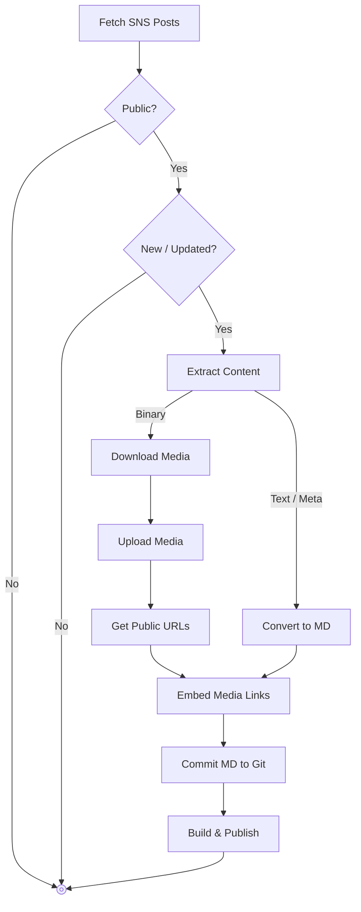

# blog-vault

## Purpose

This repository aims to provide an automated, platform-independent system for **backing up public social media posts to a personal blog**.

The system periodically retrieves public posts from social networking services (SNS), converts their text and metadata into Markdown, and backs up associated media files (such as images and videos) to external storage. Public media URLs are then embedded into the Markdown files, which are version-controlled and used to generate a static blog website.

The goal is to **preserve ownership and accessibility of personal content**, reducing dependence on individual social media platforms and the risk of content loss due to account suspension, deletion, or service shutdown.

The system is designed to be **modular and tool-agnostic**, allowing social media platforms, storage providers, and website-building tools to be replaced independently.



## Repository Structure

```text
./
├── content/              # Blog posts, media, and Obsidian vault
├── site/                 # site source and configuration
├── scripts/              # Automation, management scripts, utilities, and tests
├── .github/workflows/    # GitHub Actions for deployment and backups
├── .gitignore
└── README.md
```

The repository separates **content**, **website implementation**, and **code** into independent directories:

- **`content/`** — Markdown posts and media assets, editable directly in Obsidian.
- **`site/`** — (Astro) source code, templates, and configuration for generating the static website.
- **`scripts/`** — Scripts/code for e.g. URL management, and testing.
- **`.github/workflows/`** — GitHub Actions workflows for automated backups, site builds, and deployment to GitHub Pages.