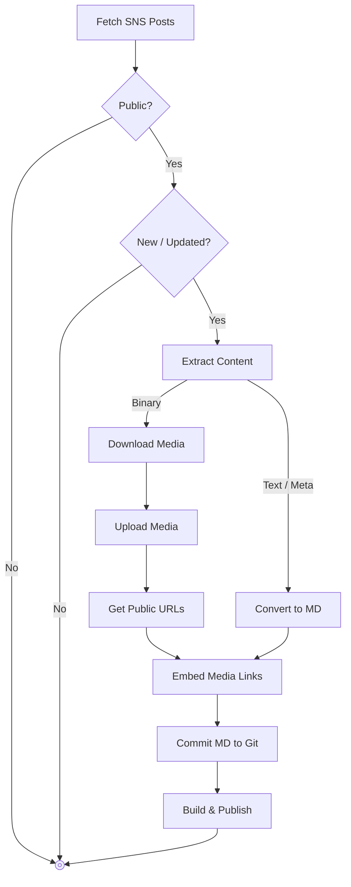
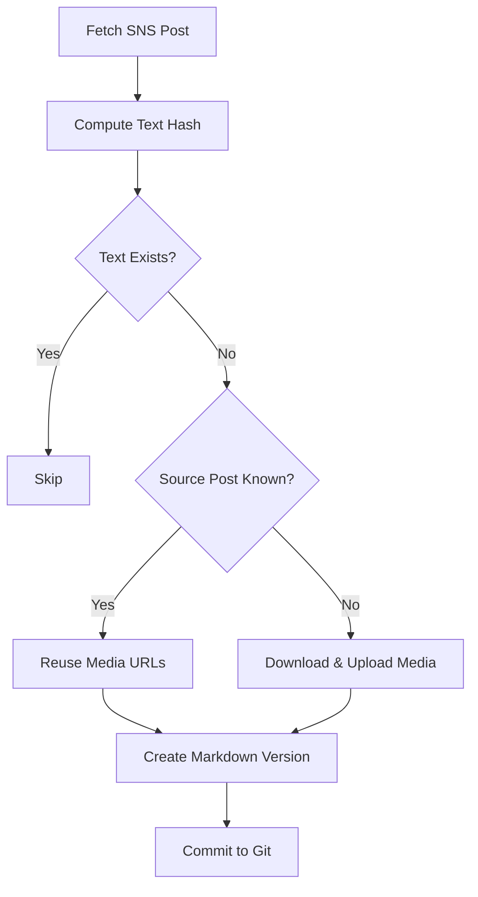

## Purpose

  

This repository aims to provide an automated, platform-independent system for **backing up public social media posts to a personal blog**.

  

The system periodically retrieves public posts from social networking services (SNS), converts their text and metadata into Markdown, and backs up associated media files (such as images and videos) to external storage. Public media URLs are then embedded into the Markdown files, which are version-controlled and used to generate a static blog website.

  

The goal is to **preserve ownership and accessibility of personal content**, reducing dependence on individual social media platforms and the risk of content loss due to account suspension, deletion, or service shutdown.

  

The system is designed to be **modular and tool-agnostic**, allowing social media platforms, storage providers, and website-building tools to be replaced independently.

  

Tools:
Contents: markdown
Metadata: yaml in front of each `.md` post
Editing tool: obsidian

Requirements

採用 Two-Repo Architecture，將內容資料與系統程式碼分離。

Content Repo (blog-content)

保存 Markdown 文章、YAML Frontmatter、SNS Metadata 與同步狀態。

可獨立作為 Obsidian Vault 使用。

不依賴 Astro 或其他 Static Site Generator。

保留文章與 Metadata 的 Git 修改歷史。

預設為 Private Repository，避免原始備份資料意外公開。

System Repo (blog-system)

保存 Astro 網站、SNS API Adapters、Automation Scripts、Tests 與 GitHub Actions Workflows。

負責 SNS 擷取、Change Detection、Deduplication、Markdown Conversion 與 Media Processing。

負責 Static Site Build、Validation 與 Deployment。

可設為 Public Repository，但不得包含 Credentials 或私人內容。

Cross-Repository Integration

GitHub Actions 可讀取及寫入 Private Content Repo。

使用最小權限的 Fine-grained PAT 或 GitHub App 進行跨 Repo 存取。

不要求 Content Repo 更新後立即觸發網站建置。

System Repo 至少支援定期自動建置與部署（Scheduled Build / Deployment），並可手動觸發。

每次建置時讀取 Content Repo 的最新可用內容。

Astro 可直接讀取外部 Markdown，不要求內容位於 Astro 預設目錄。

建置時固定 Content Commit SHA，確保結果可重現。

Automation & Reliability

將 SNS Backup 與 Website Deployment 分為獨立 Pipelines。

Backup Pipeline 將結果 Commit & Push 至 Content Repo。

Deployment Pipeline 僅讀取 Content Repo，不修改原始文章。

支援 Scheduled 與 Manual Triggers，不強制使用跨 Repo 即時觸發。

支援 Idempotent Execution、Retry、Concurrency Control 與 Git Conflict Handling。

同步失敗不得造成已有備份資料遺失。

網站建置失敗時不得影響既有備份資料或已成功部署的網站版本。

Privacy & Security

僅允許 visibility: public 的文章進入公開網站。

私人文章、附件與 Metadata 不得出現在 HTML、Search Index、RSS、Sitemap 或 Build Artifacts。

未明確標示公開的內容預設不發布。

API Tokens 使用 GitHub Actions Secrets 管理。

不允許不受信任的 Workflow 存取私人內容或 Secrets。

Portability & Maintainability

可獨立更新內容或系統程式碼。

可更換 Astro、Hosting Provider 或 SNS Adapter，而不需要遷移 Markdown。

支援未來多個網站共用同一 Content Repo。

優先使用 GitHub 與 Astro 官方支援的整合機制，避免不必要的客製化工具。
## **2. SNS **

| 平台／帳號類型                      | 讀取自己的貼文 | 發布貼文  | 免費使用評估          |
| ---------------------------- | ------- | ----- | --------------- |
| Facebook 個人檔案                | 受限      | x     | 不適合官方 API 全自動化  |
| Facebook 粉絲專頁                | o       | o     | 可免費使用，需權限       |
| Instagram 一般個人帳號             | x       | x     | 不支援目前的正式 API    |
| Instagram Creator / Business | o       | o     | 可免費使用，需權限       |
| Threads                      | o       | o     | 有免費官方 API，具配額限制 |
| Bluesky                      | o       | o     | 免費且限制相對寬鬆       |
| Mastodon                     | o       | o     | 免費，依伺服器限制       |
| X / Twitter                  | 依付費額度   | 依付費額度 | 不宜假設能完全免費       |

- **Requirements**
    - 優先支援手機發文。
    - 能透過 API 讀取自己的貼文。
    - 免費 API 優先。
    - 盡可能支援圖片、影片、Reels。
- Verdict: 藉由meta帳號連動 FB, IG, Threads 都能同步貼文
	- 以 FB, IG 發文為主，因為能同步格式較多
	- 以IG為主要貼文資訊截取方式 （除免費外，因其允許多帳號，可能較不容易被ban)

### **2.3 Scheduled Fetch**

- **Requirements**
	- 定期檢查 SNS 是否有新貼文。
	- 不需個人電腦持續運作。
	- 自動/手動觸發。
- **Verdict:** GitHub Actions Schedule

### **2.4 Public Content Filtering**

- **Requirements**
	- 只將允許公開的貼文發布到網站。
	- 私人貼文不得意外公開。
	- 支援手動排除特定文章。

### 2.5 Change Detection & Deduplication

- **Requirements**
  - 使用文字內容 SHA-256 偵測新增或修改的內容。
  - 相同文字內容不重複建立 Markdown。
  - 文字修改後視為新版本，採 Append-only Backup。
  - **假設文字修改不影響原貼文的 Binary Files。**
  - 同一來源貼文的文字更新時，直接重用既有媒體 URL，不重新下載或上傳。
  - 保留 SNS Platform、Post ID 與媒體 URL 的對應關係。
  - 暫不偵測媒體新增、刪除或修改。
  - 未來可擴充 Binary SHA-256 與 pHash 去重機制。

### **2.6 Content Conversion**

- **Requirements**
	- 將 SNS 貼文轉換為 Markdown。
	- 保存原始發文時間。
	- 保留文字、連結及媒體順序、metadata。
	- 支援不同 SNS 的格式差異。
- **Verdict:** Python + Platform-specific Adapters

### **2.7 Deleted Posts**

- **Requirements**
	- SNS 原文刪除時，不應直接失去備份。
	- 能記錄來源貼文已刪除或無法存取。

## **3. Media Storage & Hosting**

### **3.1 Private Media Backup**

- **Requirements**
	- 可儲存大量原始照片與影片。
	- 預設私人保存。
	- 支援選擇性公開。
	- 偏好一次性 Lifetime 付費。
- **Verdict:** pCloud

### **3.2 Public Media Hosting**

- **Requirements**
	- 能取得可嵌入網站的公開 URL。
	- 圖片可在 Markdown 及 Obsidian 顯示。
	- 影片可透過 HTML 嵌入。
	- 公開連結盡可能穩定。
- **Verdict:** pCloud Public Links / Public Folder

### **3.3 Automated Media Upload**

- **Requirements**
	- 自動下載 SNS 媒體原檔。
	- 上傳到指定雲端資料夾。
	- 取得公開 URL 並回填 Markdown。
	- 支援上傳失敗重試。(可設定重試次數，失敗需詳細記錄在 log)
- **Verdict:** pCloud API

### **3.4 Media URL Management**

- **Requirements**
	- Markdown 可直接顯示圖片。
	- Obsidian 本機預覽不需特殊外掛。
	- 更換儲存服務時能批次修改 URL。（未來可透過script手動執行以修改、管理）
	- 儘量降低架構複雜度。
- **Verdict:** Direct URLs in Markdown + Migration Script

### **3.5 Media Integrity**

- **Requirements**
	- 確認下載與上傳的檔案完整。
	- 避免重複上傳相同媒體。
	- 保留原始檔案與媒體 Metadata。
- **Verdict:** SHA-256 Hash
- **Alternative:** File Size + Metadata
- **Status:** Provisional

### **3.6 Storage Traffic & Cost**

- **Requirements**
	- 優先免費或低成本。
	- 不希望因流量超額產生不可預期費用。
	- 可接受流量達額後暫時無法存取。
- **Verdict:** pCloud Shared-link Traffic Quota
- **Alternative:** Cloudflare R2 with Budget Controls
- **Status:** Provisional

## **4. Static Website**

### **4.1 Static Site Generator**

- **Requirements**
	- 支援 Markdown。
	- 不需常駐後端。
	- 可自訂部落格版面。
	- 可加入搜尋、分頁及 JavaScript 功能。
- **Verdict:** Astro
- **Alternative:** Hugo
- **Status:** Selected

### **4.2 Website Hosting**

- **Requirements**
	- 免費 Static Site Hosting。
	- GitHub Repository 整合。
	- 支援自動部署及 HTTPS。
	- 可在未來遷移至其他平台。
- **Verdict:** GitHub Pages
- **Alternative:** Cloudflare Pages
- **Status:** Selected

### **4.3 Automatic Deployment**

- **Requirements**
	- Markdown 更新後自動建置網站。
	- 不需要手動上傳 HTML。
	- 建置失敗時保留上一個正常網站版本。
- **Verdict:** GitHub Actions
- **Alternative:** Cloudflare Pages Build
- **Status:** Selected

### **4.4 Chronological Post Feed**

- **Requirements**
	- 類似 Facebook 貼文列表。
	- 最新貼文排最前面。
	- 首頁可直接閱讀貼文內容。
	- 支援圖片、影片及原始貼文連結。
- **Verdict:** Astro Chronological Feed
- **Alternative:** Hugo List Templates
- **Status:** Selected

### **4.5 Pagination**

- **Requirements**
	- 大量貼文時避免一次載入全部內容。
	- 支援分頁及依時間排序。
	- 保持靜態網站架構。
- **Verdict:** Astro Built-in Pagination
- **Alternative:** Client-side Pagination
- **Status:** Selected

### **4.6 Infinite Scroll**

- **Requirements**
	- 捲動到底時自動載入更多貼文。
	- 不需要動態後端。
	- 保持網站初次載入速度。
- **Verdict:** IntersectionObserver
- **Alternative:** Load More Button
- **Status:** Provisional

### **4.7 Full-text Search**

- **Requirements**
	- 搜尋文章標題及內文。
	- 不需要搜尋伺服器。
	- 可在 GitHub Pages 運作。
	- 支援大量 Markdown 文章。
- **Verdict:** Pagefind
- **Alternative:** Lunr.js
- **Status:** Selected

### **4.8 Post Permalinks**

- **Requirements**
	- 每篇文章有獨立 URL。
	- 文章更新後 URL 保持不變。
	- 避免依賴可能變更的文章標題。
- **Verdict:** Astro Dynamic Routes + Stable Slugs
- **Alternative:** Hugo Permalinks
- **Status:** Provisional

### **4.9 Responsive Design**

- **Requirements**
	- 桌面及手機可正常閱讀。
	- 圖片及影片自動適應螢幕。
	- 保持簡單、輕量。
- **Verdict:** Astro + CSS
- **Alternative:** Astro + Tailwind CSS
- **Status:** Provisional

## **5. Automation & Development**

### **5.1 Automation Runtime**

- **Requirements**
	- 可在 GitHub Actions 及本機執行。
	- 方便處理 API、JSON、Markdown、媒體檔案。
	- 方便測試及維護。
- **Verdict:** Python
- **Alternative:** TypeScript
- **Status:** Selected

### **5.2 Python Dependency Management**

- **Requirements**
	- 快速安裝。
	- 鎖定相依套件版本。
	- 環境可重現。
- **Verdict:** uv
- **Alternative:** pip + venv
- **Status:** Provisional

### **5.3 Frontend Dependency Management**

- **Requirements**
	- 管理 Astro 與其他 JavaScript 套件。
	- 使用 Lockfile。
	- 減少重複相依套件。
- **Verdict:** pnpm
- **Alternative:** npm
- **Status:** Selected

### **5.4 Secrets Management**

- **Requirements**
	- SNS Access Token 與雲端 API Token 不可公開。
	- 不將 Credentials 提交至 Git。
	- 支援 GitHub Actions 自動化。
- **Verdict:** GitHub Actions Secrets
- **Alternative:** External Secret Manager
- **Status:** Selected

### **5.5 Testing**

- **Requirements**
	- 測試 SNS 解析與 Markdown 轉換。
	- 測試媒體上傳與 URL。
	- 驗證文章 Metadata。
	- 確保網站可正常建置。
- **Verdict:** pytest + Astro Build
- **Alternative:** Node.js Test Runner
- **Status:** Provisional

### **5.6 Error Handling & Recovery**

- **Requirements**
	- API 失敗時可重試。
	- 支援 Rate Limit 與暫時性網路錯誤。
	- 重複執行不產生重複資料。
	- 紀錄失敗貼文及處理狀態。
- **Verdict:** Retry + Checkpoint + Idempotent Jobs
- **Alternative:** Manual Rerun + Logs
- **Status:** Provisional

## **6. Cross-SNS Publishing (Future Scope)**

### **6.1 Native Cross-sharing**

- **Requirements**
	- Instagram 發文後盡可能自動分享到 Facebook。
	- 減少自行維護多平台發布 API。
	- 確認 API 發布的貼文是否也會觸發原生同步。
- **Verdict:** Meta Native Cross-sharing
- **Alternative:** Separate Platform API Publishing
- **Status:** Pending

### **6.2 Markdown to SNS Publishing**

- **Requirements**
	- 從 Markdown 發布到多個 SNS。
	- 支援文字與圖片。
	- 保存各平台發布後的 Post ID。
- **Verdict:** Official Publishing APIs
- **Alternative:** Browser Automation
- **Status:** Pending

### **6.3 Multi-platform Support**

- **Requirements**
	- Facebook、Instagram、Threads。
	- Bluesky、Mastodon。
	- X / Twitter（視 API 費用及限制）。
	- 各平台可以獨立啟用或停用。
- **Verdict:** Modular Platform Adapters
- **Alternative:** n8n
- **Status:** Pending

### **6.4 Cross-platform Post Mapping**

- **Requirements**
	- 識別同一文章在不同平台的副本。
	- 保存各平台的 Post ID 與 URL。
	- 避免重複備份同一媒體。
- **Verdict:** Metadata Mapping
- **Alternative:** SQLite
- **Status:** Pending

## **7. Privacy, Backup & Portability**

### **7.1 Private Content Isolation**

- **Requirements**
	- 私人備份不可因 GitHub Pages 部署而公開。
	- 文章公開狀態與 Repository 權限分離。
	- 避免公開 Git History 中的私人資料。
- **Verdict:** Private Source Repository + Public Site Deployment
- **Alternative:** Separate Private Backup Repository
- **Status:** Pending

### **7.2 Disaster Recovery**

- **Requirements**
	- GitHub 或 pCloud 無法使用時仍能還原資料。
	- Markdown 與媒體原檔可獨立匯出。
	- 不依賴特定網站產生器。
- **Verdict:** Local / Offline Backup
- **Alternative:** Secondary Cloud Backup
- **Status:** Pending

### **7.3 Storage Migration**

- **Requirements**
	- 可批次更新所有 Markdown 中的圖片 URL。
	- 不需手動逐篇修改。
	- 保留原始媒體與貼文對應關係。
- **Verdict:** Python Migration Script
- **Alternative:** Asset Manifest
- **Status:** Selected

## **8. Pending Decisions — 優先驗證**

- **P0 — SNS API**
- Instagram Professional 能否免費讀取所需的貼文、圖片及 Reels？
- Facebook 個人 Profile 是否有符合需求的官方讀取方式？
- API 權限、免費額度與 Token 更新機制為何？
- **P0 — pCloud**
- 能否透過 API 自動上傳？
- 能否自動取得可嵌入網站的公開 URL？
- 公開 URL 是否穩定？
- 流量超額時是否只停止存取而不產生額外費用？
- **P0 — Privacy**
- 原始 Repository 要 Public 還是 Private？
- 私人文章與公開網站如何隔離？
- **P1 — Synchronization**
- 原文修改時是否同步覆蓋備份？
- 原文刪除時如何保留歷史？
- 多平台重複貼文如何識別？
- **P1 — Backup**
- 是否需要第二份離線或異地備份？
- 如何確保媒體及 Metadata 能完整還原？
- **P2 — Cross-posting**
- 是否需要 Markdown → SNS 雙向發布？
- 哪些平台值得支援？
- 是否需要 n8n 或 Browser Automation？

**建議實作順序：** Static Blog → Media Storage PoC → SNS API PoC → Automated Backup → Multi-SNS Integration → Optional Cross-posting。