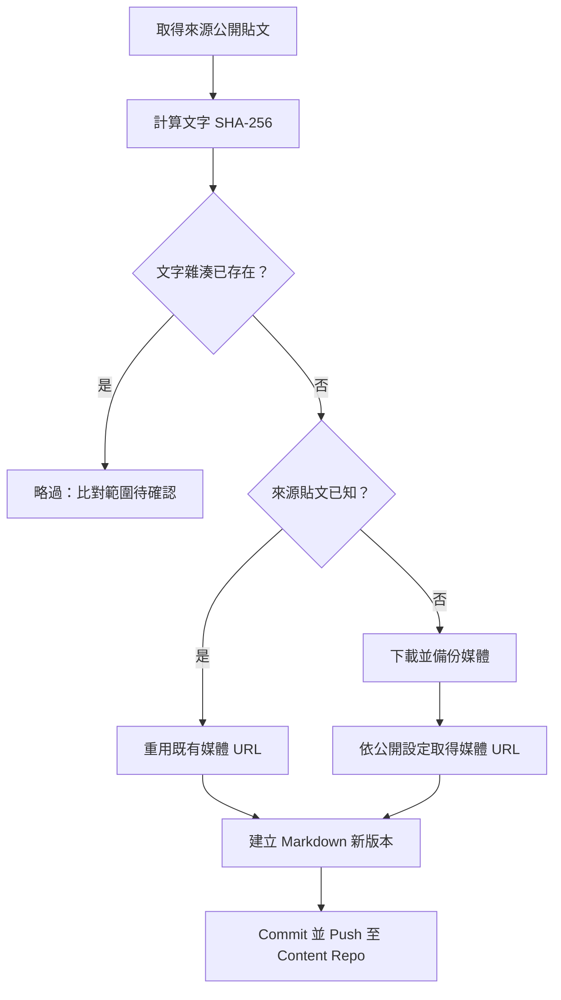

# 社群貼文備份系統：需求規格與技術方案

本系統定期備份自己的公開社群貼文，保存文字、Metadata 與媒體原檔，並將經允許公開的內容發布為個人靜態部落格。目標是保留個人內容的所有權與可存取性，降低帳號停權、貼文刪除或平台關閉造成的資料遺失風險。

本文依原稿整理，分開描述「必須達成的需求」與「目前偏好的實作方式」。工具選型及平台能力尚未經本次查證；未定義清楚的行為集中列於待確認事項。

- [一、範圍與原則](#一範圍與原則)
- [二、需求規格](#二需求規格)
- [三、解決方案與工具選型](#三解決方案與工具選型)
- [四、待確認事項](#四待確認事項)
- [五、建議驗收情境](#五建議驗收情境)

---

## 一、範圍與原則

### 1.1 系統範圍

- 從 SNS 讀取自己的公開貼文，定期檢查新增與文字更新。
- 將貼文保存為可獨立閱讀、編輯與搬遷的內容檔案。
- 下載並備份關聯圖片、影片及其 Metadata。
- 依公開狀態篩選內容，自動建置與部署個人部落格。
- 保存歷史版本，支援資料匯出、災難復原與儲存服務遷移。

### 1.2 設計原則

- **備份與發布分離**：備份成功不依賴網站部署成功。
- **內容與程式分離**：可獨立更新內容或系統程式碼。
- **預設不公開**：未明確允許公開的文章、附件與 Metadata 不得發布。
- **降低平台綁定**：SNS、媒體儲存服務、網站產生器與 Hosting 可分別替換。
- **自動化與低成本**：不需個人電腦持續運作，優先免費或可預期的費用。

### 1.3 初期限制與後續擴充

- 初期以靜態網站為主，不需常駐後端。
- 初期只偵測文字變更；暫不偵測同一貼文的媒體新增、刪除或修改。
- 初期假設文字更新不會改變原貼文的媒體檔案。
- 搜尋、其他 JavaScript 功能、媒體內容雜湊及相似圖片去重列為後續擴充。

## 二、需求規格

本節描述預期行為與限制；具體演算法、架構與產品名稱列於第三節。

### R1. 貼文來源與擷取

- 優先配合手機發文的使用習慣。
- 能透過 API 讀取自己的貼文，免費 API 優先。
- 盡可能支援文字、連結、圖片、影片及 Reels。
- 支援不同 SNS 的格式差異，並能擴充或替換來源平台。
- 支援定期與手動觸發，不需個人電腦持續運作。

### R2. 公開狀態與發布篩選

- 僅允許明確標示 `visibility: public` 的文章進入公開網站。
- 未標示公開狀態的內容預設不發布。
- 私人文章、附件與 Metadata 不得出現在 HTML、搜尋索引、RSS、Sitemap 或部署用 Build Artifacts。
- 文章是否公開，須與儲存庫本身的存取權限分開管理。
- 初期來源擷取以公開貼文為範圍；內容庫及媒體備份仍須預設私人保存。

### R3. 變更偵測、去重與版本保存

- 能識別新增貼文與文字更新，避免重複建立相同文字內容的備份。
- 文字修改後保留為新版本，覆蓋既有版本，舊版本以 git 版控紀錄即可。
- 保留來源 SNS、Post ID、版本與媒體 URL 的對應關係。
- 同一來源貼文更新文字時，重用既有媒體 URL，不重新下載或上傳。
- 重複執行相同工作不得產生重複資料。
- 主要偵測貼文內容的不同，若不同來源相似（代表不同版本），擇取最新的為主
- 貼文附屬的非文字檔案預設假設不會更新並且需 log 此行為

### R4. 內容格式與編輯

- 將 SNS 貼文轉換為 Markdown，Metadata 使用 YAML Frontmatter 保存。
- 保存原始發文時間、文字、連結、媒體順序及來源 Metadata。
- 內容可獨立閱讀與編輯，不依賴特定網站產生器或其預設目錄。
- 內容資料夾可獨立作為 Obsidian Vault 使用。
- Markdown 中的圖片可直接顯示，Obsidian 本機預覽不需特殊外掛。
- 影片可透過 HTML 嵌入網站。

### R5. 來源刪除與無法存取

- SNS 原文刪除時，既有備份不得直接消失。
- 能記錄來源貼文已刪除或無法存取的狀態。
- 來源刪除、改為私人後，網站亦將其不公開。

### R6. 媒體備份與公開存取

- 可儲存大量原始照片與影片，預設私人保存，支援選擇性公開。
	- 若其對應貼文變為不公開，則將其亦設為不公開
- 自動下載 SNS 可取得的媒體原檔並上傳至指定雲端資料夾。
- 對允許公開的媒體取得可嵌入網站的 URL，並回填內容檔案。
- 公開 URL 盡可能穩定，可用於 Markdown 圖片及網頁影片嵌入。
- 確認下載與上傳的檔案完整，保留原始檔案及媒體 Metadata。
- 避免重複上傳相同媒體；可藉由 hash 對比區分。
	- 每次上傳可存 hash 供未來使用，可存到 metadata, 若無法，是少存成 filename
- 上傳失敗可設定重試次數，最終失敗須在 Log 詳細記錄。
- 未經允許公開的媒體，不得因上傳或產生連結而變成可公開存取。

### R7. 儲存費用與流量

- 優先免費或低成本；或至少一次性 Lifetime 付費。
- 不希望流量超額產生不可預期費用。
- 可接受流量達額後，公開媒體暫時無法存取。

### R8. 網站呈現

- 支援 Markdown，可自訂部落格版面，且不需常駐後端。
- 首頁採類似 Facebook 的貼文列表，最新貼文在前，可直接閱讀內容。
- 貼文支援圖片、影片及原始貼文連結。
- 大量貼文時採分頁，避免一次載入所有內容，維持時間排序。
- 支援捲動到底時載入更多貼文，保持初次載入速度與靜態網站架構。
- 每篇文章有獨立 URL，更新後保持不變，且不依賴可變更的標題。
- 桌面與手機均可閱讀，圖片及影片適應螢幕，整體保持簡單、輕量。
- 保留未來加入搜尋與其他 JavaScript 功能的空間。

### R9. 自動化與可靠性

- 備份與網站部署採獨立 Pipeline。
- 備份 Pipeline 將內容與同步狀態寫回內容庫。
- 部署 Pipeline 僅讀取內容，不修改原始文章。
- 至少支援定期自動建置、部署及手動觸發；不要求內容更新後立即觸發。
- 每次建置讀取內容庫最新可用內容，並固定該次使用的內容版本，確保結果可重現。
- API、網路及媒體處理失敗可重試，並處理 Rate Limit。
- 支援冪等執行、處理進度保存、並行控制及內容寫入衝突處理。
- 記錄失敗貼文、處理狀態及錯誤，供後續重試與復原。
- 同步失敗不得造成已有備份資料遺失。
- 網站建置或部署失敗不得破壞既有備份，並須保留上一個成功部署的網站版本。
- 若失敗，僅保留處理到一半的文字檔，以供手動進行編輯（非文字檔亦自行下載等處理）
- 若下次重試成功，則刪除對應上次失敗產生的中間狀態檔案，以免留垃圾

### R10. 權限與機密管理

- 內容庫預設私人，避免原始備份資料與修改歷史意外公開。
- 系統程式碼可公開，但不得包含 Credentials 或私人內容。
- SNS Access Token、雲端 API Token 與跨庫存取憑證不得提交至 Git。
- 自動化工作存取私人內容時須採最小權限。
- 不受信任的 Workflow 不得存取私人內容或 Secrets。

### R11. 可攜性、維護與災難復原

- 可獨立更新內容與系統程式碼。
- 更換網站產生器、Hosting 或 SNS Adapter 時，不需遷移既有 Markdown 格式。
- Markdown 與媒體原檔可獨立匯出；主要程式碼託管或雲端儲存服務無法使用時，仍有資料可供還原。
- 更換媒體儲存服務時，可批次更新 URL，不需逐篇手動修改。
	- 可用 ai 更改或用 script 更改即可
- 遷移時保留媒體與來源貼文的對應關係。
- 自動化程式可在本機與 CI 執行，方便處理 API、JSON、Markdown 與媒體檔案。
- 相依套件須鎖定版本、環境可重現，並兼顧安裝速度及維護便利性。
- 優先使用官方支援的整合機制，避免不必要的客製化工具。

---

## 三、解決方案與工具選型

以下保留原稿的架構決策與偏好，與需求分開管理。涉及 API、價格、配額或產品限制者，實作前須另行驗證。

### S1. 雙儲存庫架構（對應 R4、R9–R11）

採用 **Two-Repo Architecture**，分離內容與系統程式碼。

**Content Repo：預設 Private**

- 保存 Markdown、YAML Frontmatter、SNS Metadata 與同步狀態。
- 保留 Git 歷史，可獨立作為 Obsidian Vault。
- 不依賴 Astro 或其他 Static Site Generator。

**System Repo：可設為 Public**

- 保存 Astro 網站、SNS API Adapters、自動化 Scripts、Tests 及 GitHub Actions Workflows。
- 負責擷取、變更偵測、去重、Markdown 轉換、媒體處理、網站建置、驗證與部署。
- 不保存私人內容或 Credentials。

**跨儲存庫整合**

- GitHub Actions 以最小權限的 Fine-grained PAT 或 GitHub App 存取 Private Content Repo。
- 備份工作可讀寫內容庫；部署工作只需讀取權限。
- 部署時固定 Content Commit SHA，並讓 Astro 讀取外部 Markdown。
- 以定期及手動建置為基本方式，不強制跨 Repo 即時觸發。

### S2. SNS 來源策略（對應 R1）

原稿偏好以 Facebook、Instagram 手機發文為主，透過 Meta 帳號連動至 Facebook、Instagram、Threads，並優先從 Instagram 擷取貼文。

- 目前評估主要以 instagram pro account 為主，因為目前存取免費
	- 需要撰寫獨立簡單 script 測試其 API

### S3. 擷取、轉換與執行環境（對應 R1、R4、R9、R11）

- **Python + Platform-specific Adapters**：呼叫各平台 API，轉換文字、時間、連結與 Metadata。
- **GitHub Actions Schedule／Manual Trigger**：定期擷取，也可手動執行。
- **uv**：管理 Python 相依套件與鎖定版本。
- **pnpm + Lockfile**：管理 Astro 與 JavaScript 相依套件，減少重複安裝的相依套件。
- **Obsidian**：閱讀與編輯 Content Repo。

### S4. 文字雜湊與追加式備份（對應 R3）

- 使用文字內容的 **SHA-256** 偵測新增或修改。
- 文字雜湊已存在時，原稿規則為略過，不建立新 Markdown。
- 文字雜湊不存在、但來源貼文已知時，重用媒體 URL，建立新的 Markdown 版本。
- 來源貼文尚未知時，下載並上傳媒體，再建立 Markdown。
- 初期不對媒體內容重新計算雜湊；未來可加入 Binary SHA-256 與 pHash。

文字正規化、比較範圍、跨平台來源關聯及同文不同媒體的處理，須先確認再實作，避免單憑文字雜湊遺漏來源或媒體。

### S5. 媒體儲存與 URL 管理（對應 R6、R7、R11）

- **pCloud**：原稿偏好的原始照片與影片備份服務，以 Lifetime 付費選項為考量。
- **pCloud API**：自動上傳至指定資料夾，並取得適合發布的連結。
- **pCloud Public Links／Public Folder**：原稿提出的公開媒體託管方式；是否提供符合需求的圖片直連與影片嵌入方式，須驗證。
- **Direct URLs in Markdown**：在 Markdown 直接保存媒體 URL，降低預覽與網站整合的複雜度。
- **Python Migration Script**：未來手動執行批次 URL 替換及遷移，可輔以 AI 協助撰寫。
- **Shared-link Traffic Quota**：原稿偏好以流量額度控制成本；實際超額行為與費用須依方案確認。

私人備份與公開媒體的隔離方式、URL 穩定性、完整性驗證，以及初期避免重複上傳的方法，仍需細化。

### S6. 靜態網站與 Hosting（對應 R8、R9）

- **Astro**：網站產生器，讀取 Markdown，產生貼文列表及文章頁。
- **Astro Chronological Feed**：依時間倒序顯示完整貼文。
- **Astro Built-in Pagination**：產生靜態分頁。
- **IntersectionObserver**：在前端偵測捲動並載入下一頁內容。
- **Astro Dynamic Routes + Stable Slugs**：產生不依賴文章標題的固定網址。
- **CSS**：實作桌面與手機的響應式版面。
- **GitHub Pages**：原稿偏好的免費靜態網站 Hosting，需求包含 GitHub 整合、自動部署及 HTTPS；實際適用方案須確認。
- **GitHub Actions**：建置與部署，定期讀取最新內容，也可手動觸發。

### S7. 錯誤復原與 Secrets（對應 R9、R10）

- **Retry**：處理 API、網路與上傳的暫時性錯誤，重試次數可設定。
- **Checkpoint + Idempotent Jobs**：保存進度，讓失敗工作可安全重跑。
- **Concurrency Control + Git Conflict Handling**：避免並行工作相互覆寫。
- **GitHub Actions Secrets**：保存 SNS、儲存服務與跨 Repo 存取憑證。
- 備份與部署分開執行，各自保留錯誤及處理狀態。

---
